<div align="center">
<h3>UNIVERSIDAD TECNOLÓGICA DE PANAMÁ</h3>
<h4>FACULTAD DE INGENIERÍA DE SISTEMAS COMPUTACIONALES<br>CAMPUS VÍCTOR LEVIS SASSO</h4>

<h1>🌸 Laboratorio #2: Implementación del Login y Register en Laravel 12 y PHP 8.2</h1>
<p><strong>Documentación del laboratorio paso a paso</strong></p>
<table>
<tr><td><strong>Curso</strong></td><td>Desarrollo Web</td></tr>
<tr><td><strong>Instructor</strong></td><td>Ing. Irina Fong</td></tr>
<tr><td><strong>Unidad I</strong></td><td>Modelo Vista Controlador (MVC)</td></tr>
<tr><td><strong>Semestre</strong></td><td>II Semestre 2026</td></tr>
<tr><td><strong>Estudiante</strong></td><td>Nohelis Castro</td></tr>
</table>
</div>

---

## 📑 Índice

1. [Introducción y objetivo](#-introducción-y-objetivo)
2. [Tecnologías](#-tecnologías)
3. [Fase 1: Entorno de desarrollo](#-fase-1-entorno-de-desarrollo)
4. [Fase 2: Proyecto y base de datos](#-fase-2-proyecto-y-base-de-datos)
5. [Fase 3: Node.js y servidor](#-fase-3-nodejs-y-servidor)
6. [Fase 4: Login y registro](#-fase-4-login-y-registro)
7. [Fase 5: GitHub](#-fase-5-github)
8. [Errores comunes](#-errores-comunes)
9. [Conclusión](#-conclusión)
10. [Referencias](#-referencias)

---

## 🎯 Introducción y objetivo

En este laboratorio se creó una aplicación con **Laravel 12** y **PHP 8.2** que permite registrar usuarios e iniciar sesión, guardando los datos en una base de datos **MySQL**. El objetivo fue aplicar el patrón **MVC** sobre un caso real: las vistas de autenticación (Vista), los controladores de login y registro (Controlador) y el modelo `User` conectado a la tabla `users` (Modelo).

Este documento registra cada paso realizado, el motivo y la evidencia obtenida.

---

## 🔧 Tecnologías

        

| Herramienta | Uso en el laboratorio |
|:--|:--|
| **XAMPP 8.2.12** | Servidor local con Apache, MySQL, phpMyAdmin y PHP 8.2 |
| **Composer** | Gestor de dependencias de PHP, usado para instalar Laravel |
| **Node.js y npm** | Compilación de los recursos del frontend con Vite |
| **laravel/ui** | Generación de las vistas y controladores de login y registro |
| **Visual Studio Code** | Edición de los archivos del proyecto |
| **Git y GitHub** | Control de versiones y publicación del proyecto |

---

## 🧰 Fase 1: Entorno de desarrollo

### 📥 Paso 1: Descarga de XAMPP

Se descargó XAMPP desde el sitio oficial de Apache Friends, en la versión **8.2.12 / PHP 8.2.12**. Se eligió esa versión porque Laravel 12 requiere PHP 8.2 o superior, y XAMPP ya incluye en un solo paquete el servidor web, la base de datos y PHP.

https://www.apachefriends.org/es/download.html

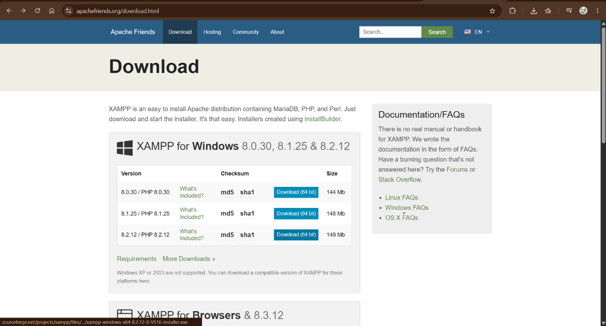

*Ilustración 1: Descarga de la versión 8.2.12 / PHP 8.2.12*

### ⚙️ Paso 2: Instalación de XAMPP

Se ejecutó el instalador con las opciones por defecto hasta completar la instalación.

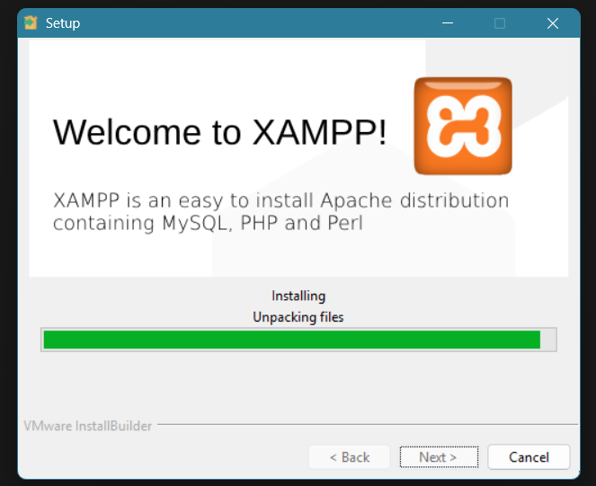

*Ilustración 2: Instalador de XAMPP*

### ▶️ Paso 3: Inicio de Apache y MySQL

Desde el panel de control de XAMPP se iniciaron los módulos **Apache** y **MySQL**. Apache sirve la aplicación en el navegador y MySQL almacena los datos, por lo que ambos deben estar activos durante todo el laboratorio.

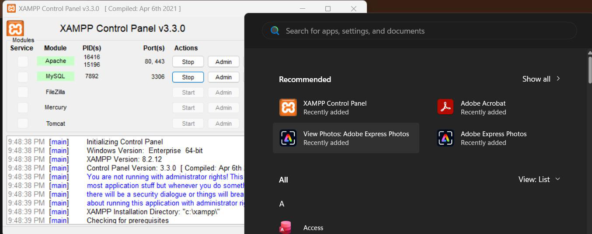

*Ilustración 3: Apache y MySQL en ejecución*

### 🧭 Paso 4: Verificación de la ruta de PHP

Se comprobó que el archivo `php.exe` existe en `C:\xampp\php`, ya que esa es la ruta que luego se agrega a las variables de entorno.

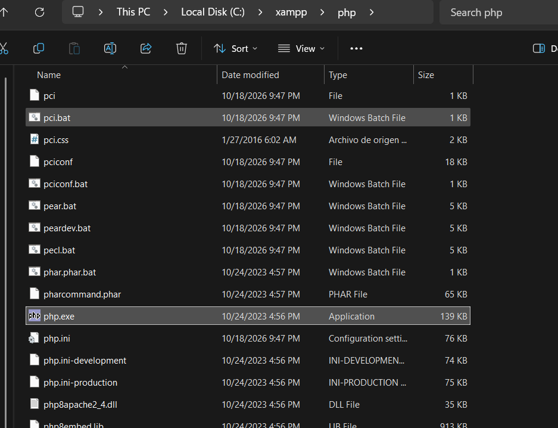

*Ilustración 4: Archivo `php.exe` dentro de `C:\xampp\php`*

### 🌍 Paso 5: PHP en las variables de entorno

Se agregó `C:\xampp\php` a la variable `Path` para poder ejecutar el comando `php` desde cualquier carpeta de la terminal. Composer y Artisan dependen de ese comando.

Primero se abrió el editor de variables de entorno desde el buscador de Windows.

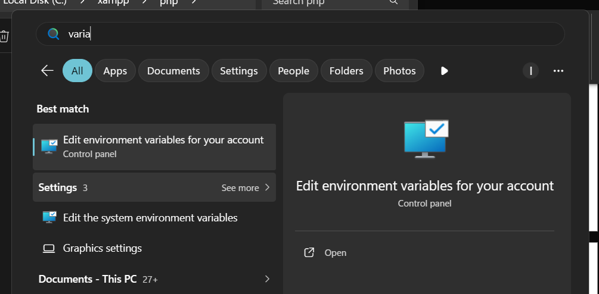

*Ilustración 5: Búsqueda de "variables" en el menú de inicio*

Luego se entró a **Environment Variables** desde las propiedades del sistema.

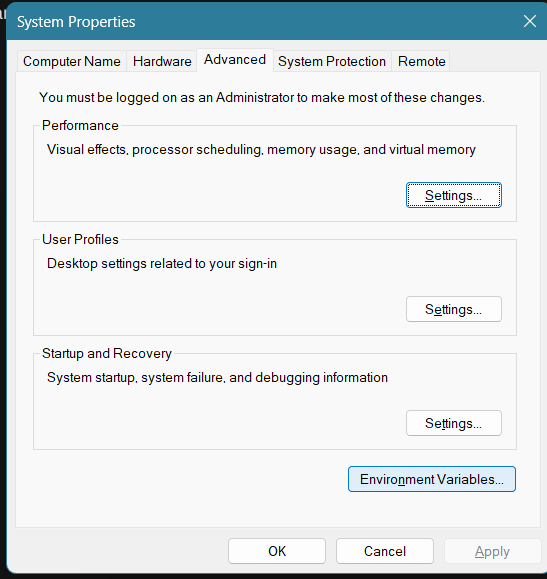

*Ilustración 6: Botón Environment Variables*

Se seleccionó la variable `Path` del usuario y se pulsó **Edit**.

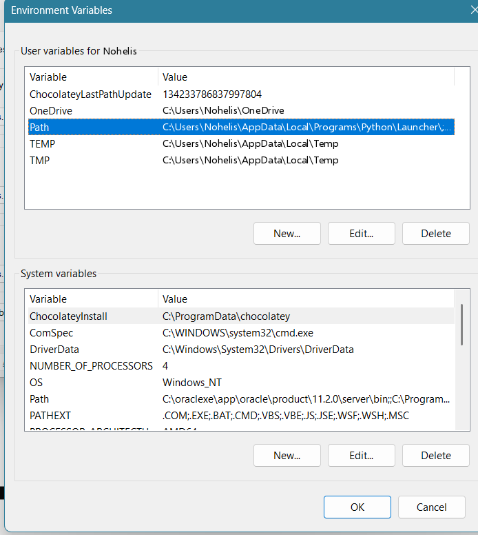

*Ilustración 7: Selección de la variable Path*

Se agregó una nueva entrada con la ruta `C:\xampp\php` y se aceptaron los cambios.

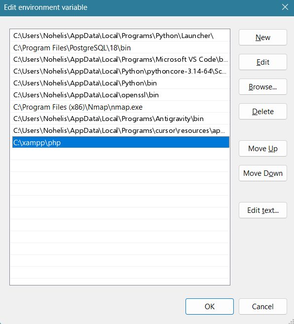

*Ilustración 8: Entrada `C:\xampp\php` agregada al Path*

### 📦 Paso 6: Descarga de Composer

Se descargó **Composer-Setup.exe** desde el sitio oficial. Composer es el gestor de dependencias de PHP y es la herramienta con la que se crea el proyecto Laravel.

https://getcomposer.org/download/

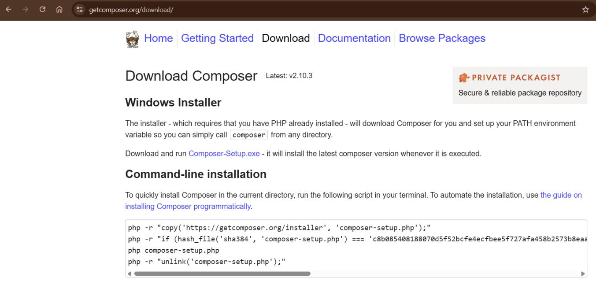

*Ilustración 9: Instalador de Composer para Windows*

### 🧩 Paso 7: Instalación de Composer

Durante la instalación se verificó que el instalador detectara el PHP de XAMPP en `C:\xampp\php\php.exe`, para que Composer use la misma versión de PHP que el servidor.

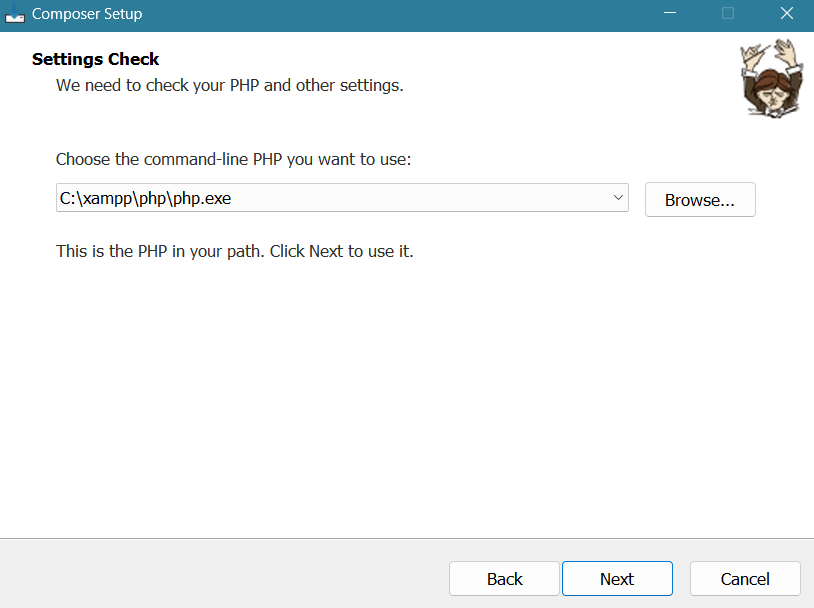

*Ilustración 10: Ruta de PHP detectada por el instalador*

### 🔍 Paso 8: Comprobación de las instalaciones

En una terminal nueva se ejecutaron los comandos para confirmar las versiones instaladas.

```bash
php -v
composer -V
```

El resultado mostró PHP 8.2.12 y Composer apuntando a `C:\xampp\php\php.exe`.

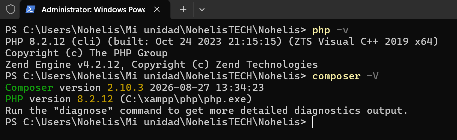

*Ilustración 11: Versiones de PHP y Composer*

---

## 🧱 Fase 2: Proyecto y base de datos

### 🚀 Paso 9: Creación del proyecto Laravel

Se creó el proyecto dentro de `C:\xampp\htdocs`, la carpeta que Apache usa como raíz web. Se indicó `^12.0` para instalar específicamente Laravel 12.

```bash
cd C:\xampp\htdocs
composer create-project laravel/laravel:^12.0 Laboratorio2MVC
cd Laboratorio2MVC
php artisan --version
```

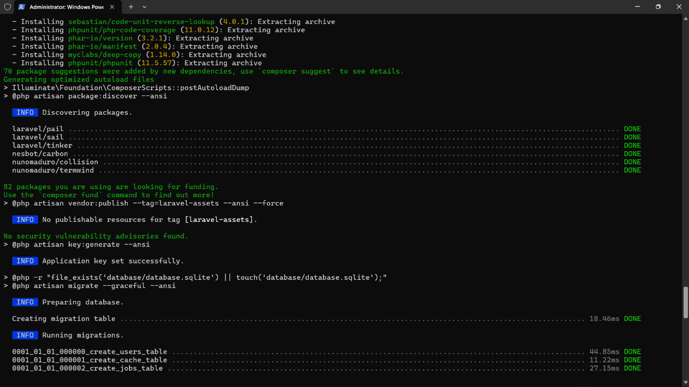

*Ilustración 12: Composer instalando Laravel y sus dependencias*

El último comando confirmó la instalación de Laravel Framework 12.

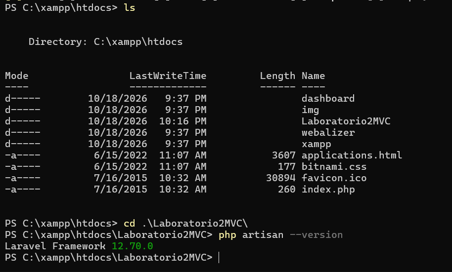

*Ilustración 13: Laravel Framework 12 instalado*

### 💾 Paso 10: Creación de la base de datos

Desde phpMyAdmin se creó la base de datos `laboratorio2mvc`, donde Laravel guardará las tablas y los usuarios.

http://localhost/phpmyadmin/index.php?route=/server/databases

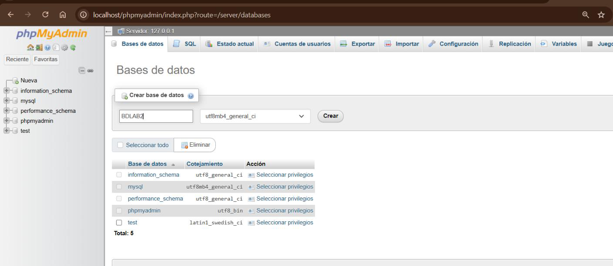

*Ilustración 14: Creación de la base de datos en phpMyAdmin*

### 📝 Paso 11: Configuración del archivo `.env`

Se editó el archivo `.env` para que Laravel use MySQL y se conecte a la base creada. El usuario `root` sin contraseña es el acceso por defecto de XAMPP.

```env
DB_CONNECTION=mysql
DB_HOST=127.0.0.1
DB_PORT=3306
DB_DATABASE=laboratorio2mvc
DB_USERNAME=root
DB_PASSWORD=
```

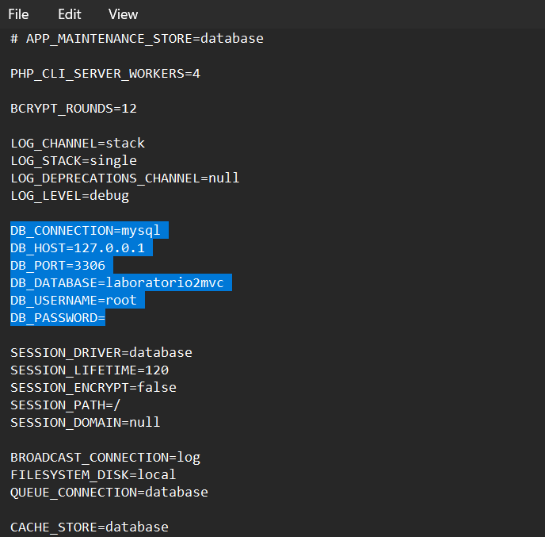

*Ilustración 15: Variables de conexión a la base de datos*

### 🧬 Paso 12: Modificación de `AppServiceProvider.php`

En `app\Providers\AppServiceProvider.php` se agregó `Schema::defaultStringLength(191)` dentro del método `boot()`. Este ajuste limita la longitud por defecto de los campos de texto y evita errores de longitud de índice al crear las tablas en MySQL.

```php
<?php

namespace App\Providers;

use Illuminate\Support\ServiceProvider;
use Illuminate\Support\Facades\Schema;

class AppServiceProvider extends ServiceProvider
{
    public function register(): void
    {
        //
    }

    public function boot(): void
    {
        Schema::defaultStringLength(191);
    }
}
```

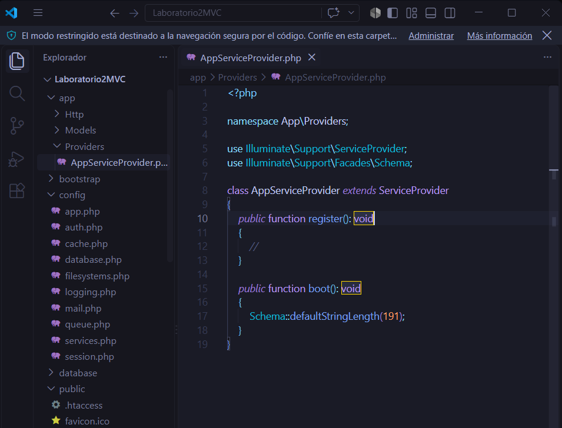

*Ilustración 16: Archivo `AppServiceProvider.php` modificado*

### 🔄 Paso 13: Migraciones

Se limpió la caché de configuración para que Laravel leyera el `.env` actualizado y luego se ejecutaron las migraciones, que crean las tablas en la base de datos.

```bash
php artisan config:clear
php artisan migrate
```

Todas las migraciones terminaron en **DONE**.

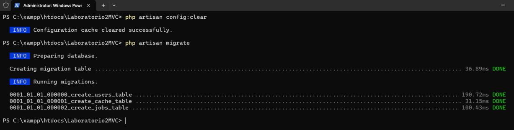

*Ilustración 17: Migraciones ejecutadas*

En phpMyAdmin se comprobó que se crearon las 9 tablas: `cache`, `cache_locks`, `failed_jobs`, `jobs`, `job_batches`, `migrations`, `password_reset_tokens`, `sessions` y `users`.

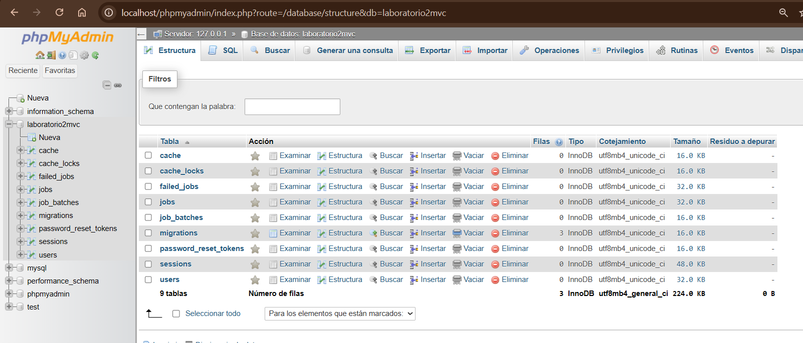

*Ilustración 18: Tablas de la base de datos `laboratorio2mvc`*

---

## ⚡ Fase 3: Node.js y servidor

### 🟢 Paso 14: Instalación de Node.js

Se instaló Node.js desde el sitio oficial, marcando la opción de agregarlo al PATH. Laravel usa Vite para compilar los recursos del frontend y Vite necesita Node.js y npm.

https://nodejs.org/en/download

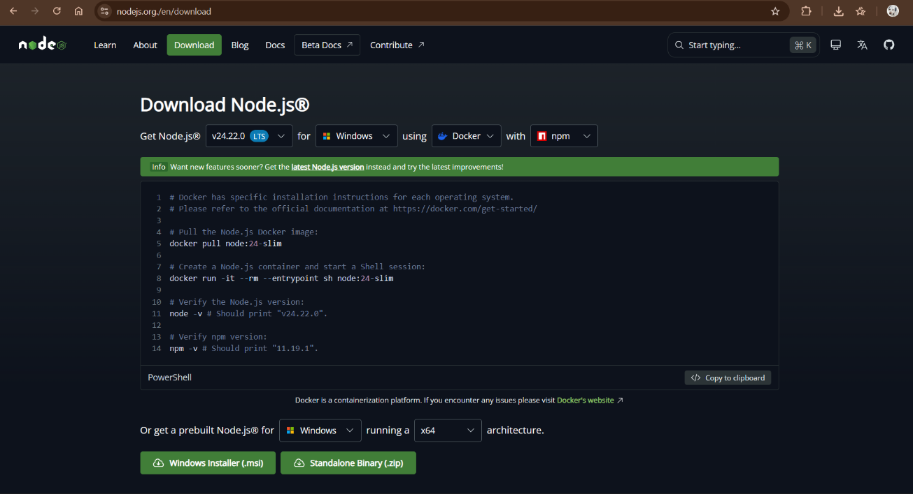

*Ilustración 19: Descarga de Node.js para Windows*

Se verificó la instalación en una terminal nueva.

```bash
node -v
npm -v
```

Como PowerShell bloqueó la ejecución de scripts al usar `npm`, se habilitó con:

```powershell
Set-ExecutionPolicy -Scope CurrentUser RemoteSigned
```

### 📚 Paso 15: Instalación de dependencias de Node

Dentro de la carpeta del proyecto se instalaron las dependencias del frontend definidas en `package.json`.

```bash
npm install
```

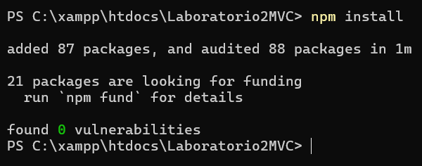

*Ilustración 20: Dependencias instaladas sin vulnerabilidades*

### 🌐 Paso 16: Inicio del servidor de desarrollo

Se levantó el servidor con `composer run dev`, que inicia a la vez el servidor de Laravel y Vite. La terminal se dejó abierta mientras se probaba la aplicación.

```bash
composer run dev
```

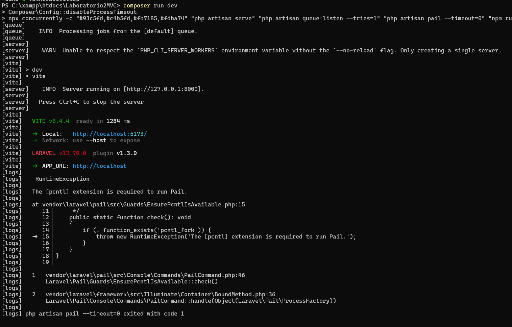

*Ilustración 21: Servidor corriendo en `http://127.0.0.1:8000`*

### 🖥️ Paso 17: Verificación en el navegador

Se abrió `http://127.0.0.1:8000` y se obtuvo la pantalla de bienvenida de Laravel, lo que confirmó que el proyecto funcionaba antes de agregar la autenticación.

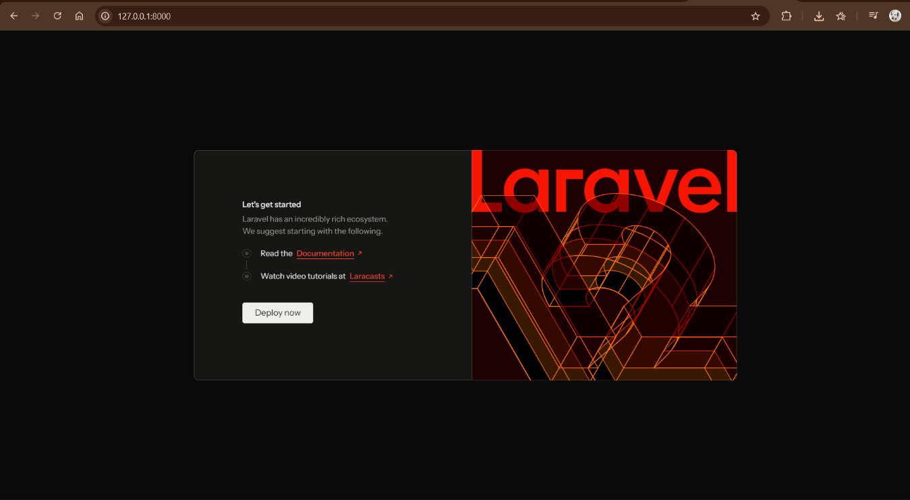

*Ilustración 22: Pantalla de bienvenida de Laravel*

### 🛑 Paso 18: Detención del servidor

Se detuvo el servidor con `Ctrl + C` y `Y` para poder instalar el paquete de autenticación.

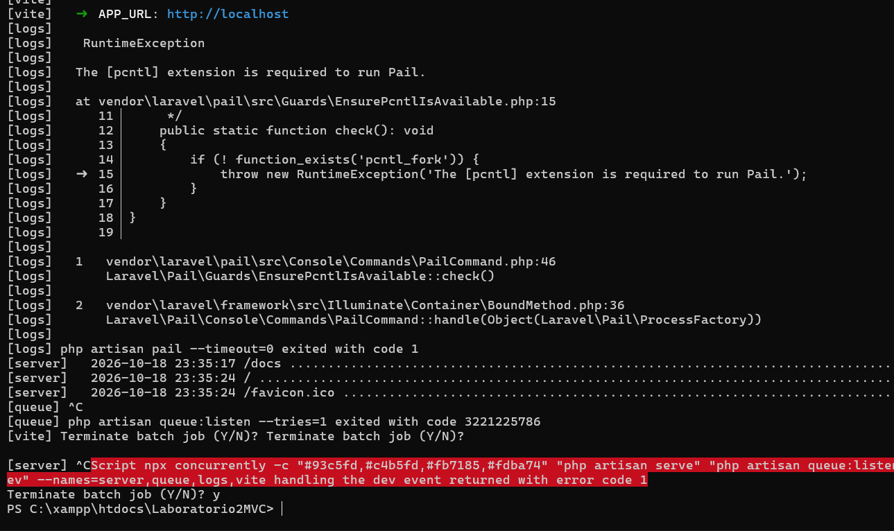

*Ilustración 23: Servidor detenido*

---

## 🔑 Fase 4: Login y registro

### 🔌 Paso 19: Instalación de `laravel/ui`

Se instaló el paquete `laravel/ui`, que genera las vistas y controladores de autenticación.

```bash
composer require laravel/ui
```

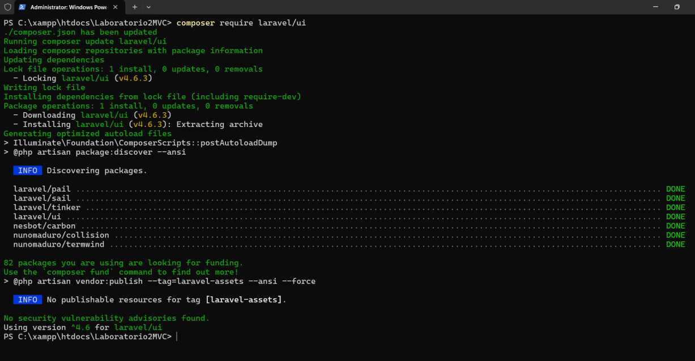

*Ilustración 24: Paquete `laravel/ui` instalado*

### 🎨 Paso 20: Generación de Bootstrap y autenticación

Con Artisan se generaron las vistas de login y registro con Bootstrap, junto con los controladores de autenticación. Se respondió `yes` para reemplazar el `Controller.php` existente.

```bash
php artisan ui bootstrap --auth
```

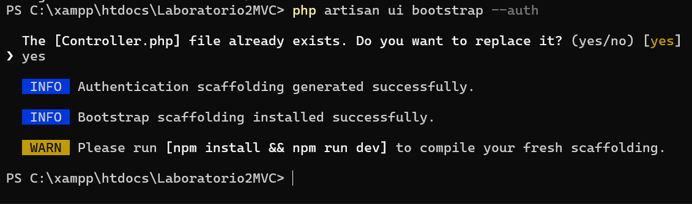

*Ilustración 25: Autenticación y Bootstrap generados*

### 📚 Paso 21: Reinstalación de dependencias

Se ejecutó `npm install` otra vez porque el scaffolding agregó nuevas dependencias de frontend.

```bash
npm install
```

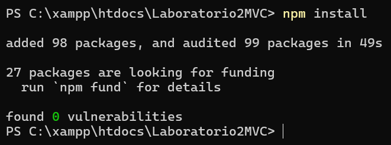

*Ilustración 26: Segunda instalación de dependencias*

### ♻️ Paso 22: Nuevo inicio del servidor

Se volvió a levantar el servidor para probar las vistas generadas.

```bash
composer run dev
```

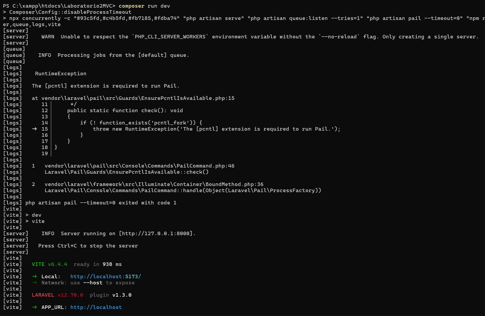

*Ilustración 27: Servidor corriendo con la autenticación instalada*

### 📝 Paso 23: Registro de un usuario

Se abrió `http://127.0.0.1:8000/register`, donde `laravel/ui` creó el formulario de registro.

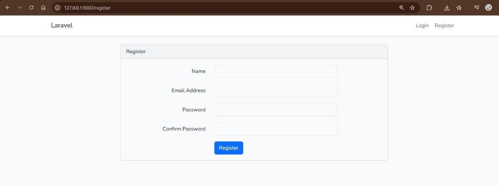

*Ilustración 28: Formulario de registro*

Se completaron el nombre, el correo y la contraseña con su confirmación.

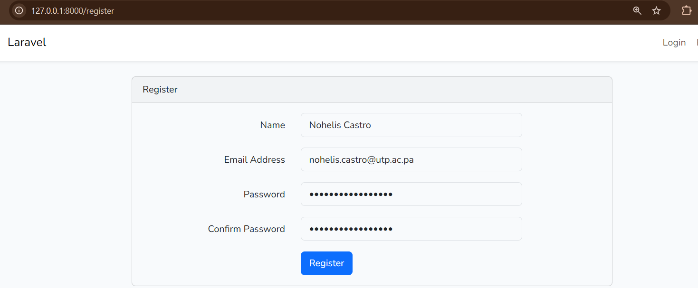

*Ilustración 29: Datos del usuario ingresados*

Tras registrarse, la aplicación redirigió a `/home` con el mensaje **You are logged in!**, lo que confirmó que el registro funcionó.

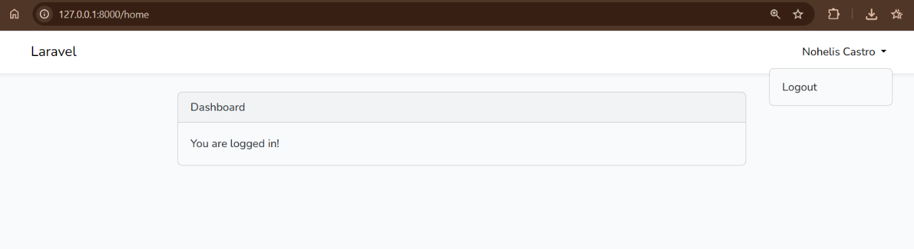

*Ilustración 30: Dashboard luego del registro*

### 🔓 Paso 24: Inicio de sesión

Se cerró la sesión y se abrió `http://127.0.0.1:8000/login` para iniciar sesión con las credenciales del usuario creado.

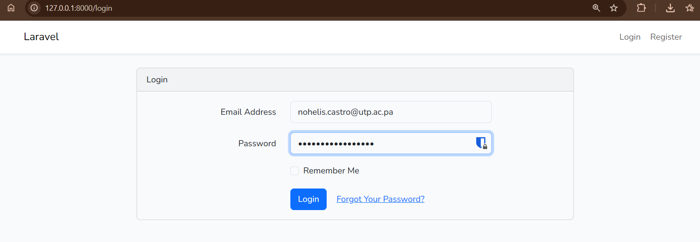

*Ilustración 31: Formulario de inicio de sesión*

El acceso fue exitoso y se mostró de nuevo el mensaje **You are logged in!**.


*Ilustración 32: Sesión iniciada correctamente*

### 🗃️ Paso 25: Verificación en la base de datos

En phpMyAdmin se consultó la tabla `users` y se confirmó que el usuario quedó guardado. La contraseña aparece cifrada con hash y no en texto plano.

http://localhost/phpmyadmin/index.php?route=/sql&db=laboratorio2mvc&table=users&pos=0

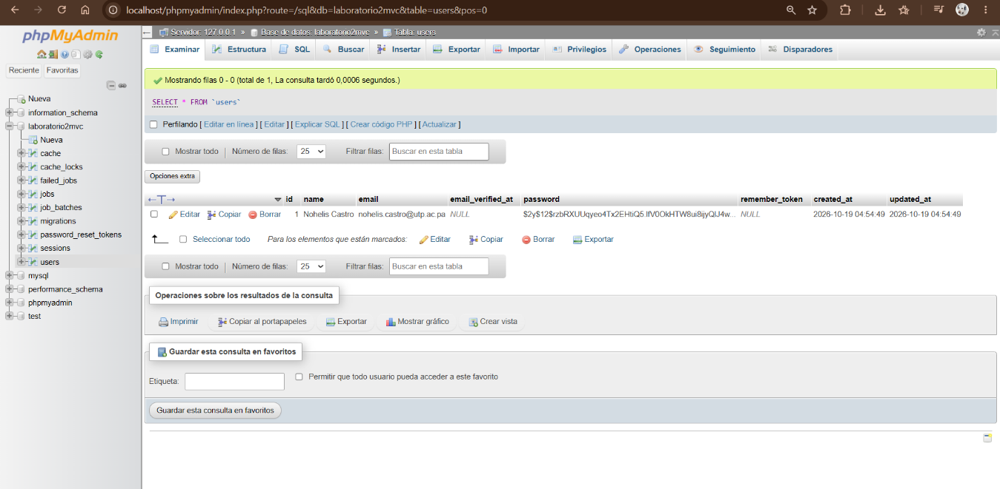

*Ilustración 33: Usuario registrado en la tabla `users`*

---

## 🐙 Fase 5: GitHub

### 🆕 Paso 26: Creación del repositorio

En GitHub se creó el repositorio `Laboratorio2-LaravelMVC` para publicar el proyecto.

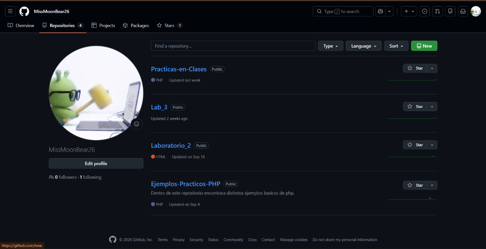

*Ilustración 34: Creación de un nuevo repositorio*

Se dejó la configuración por defecto y se pulsó **Create repository**.

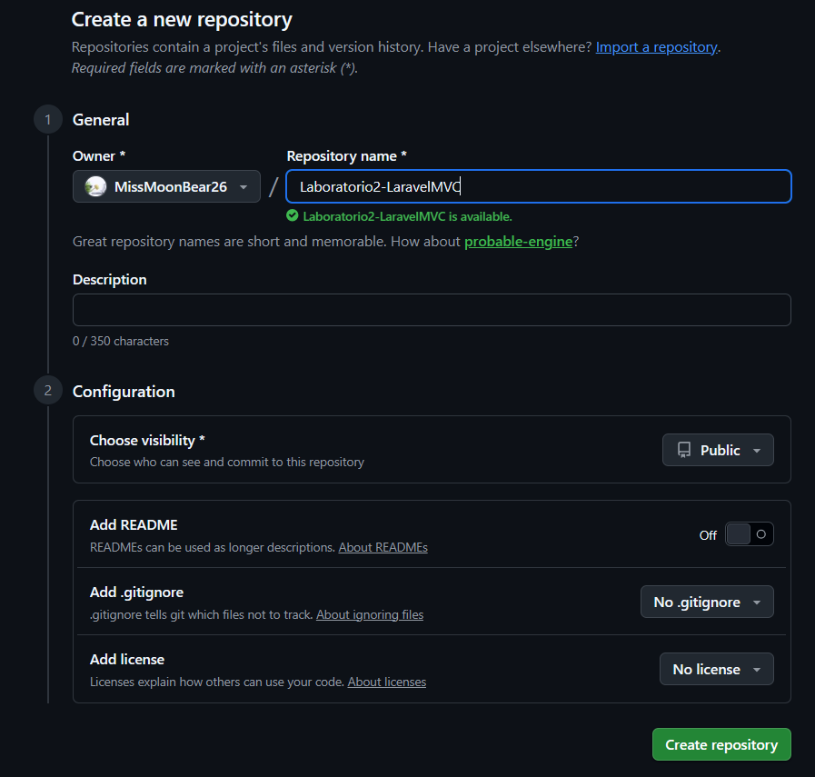

*Ilustración 35: Configuración del repositorio*

### 📂 Paso 27: Ubicación en el proyecto

En una terminal nueva se entró a la carpeta del proyecto para trabajar con Git desde ahí.

```bash
cd C:\xampp\htdocs\Laboratorio2MVC
```

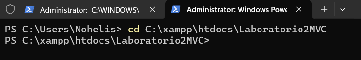

*Ilustración 36: Terminal en la carpeta del proyecto*

### 📤 Paso 28: Commit y publicación

Se inicializó el repositorio local, se agregaron todos los archivos y se revisó el estado.

```bash
git init
git add .
git status
```

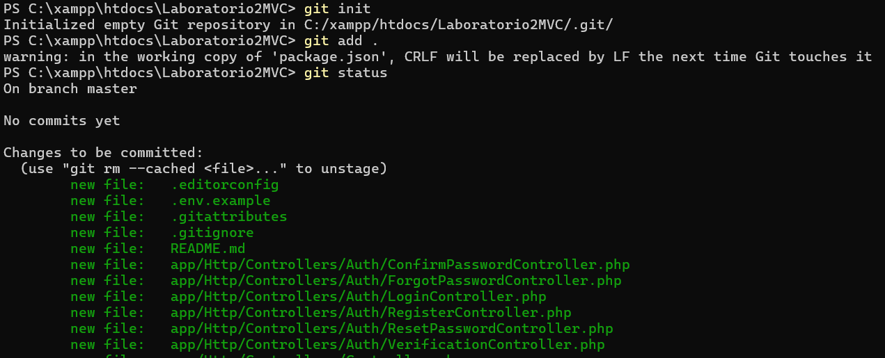

*Ilustración 37: Archivos preparados para el commit*

Se creó el commit inicial.

```bash
git commit -m "Laboratorio 2: login y registro con Laravel 12"
```

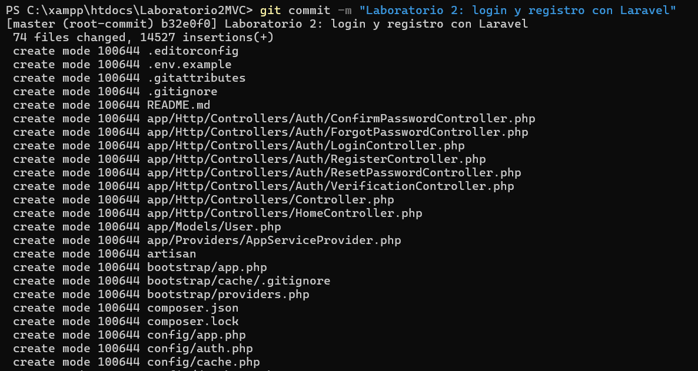

*Ilustración 38: Commit creado*

Finalmente se conectó el repositorio local con GitHub y se subieron los archivos.

```bash
git branch -M main
git remote add origin https://github.com/MissMoonBear26/Laboratorio2-LaravelMVC.git
git push -u origin main
```

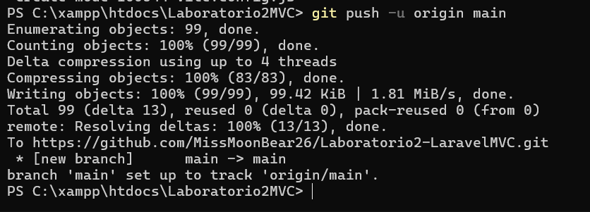

*Ilustración 39: Proyecto subido a GitHub*

---

## 🚑 Errores comunes

Problemas frecuentes que pueden aparecer durante el laboratorio y su solución.

| Error | Causa | Solución |
|:--|:--|:--|
| `php` no se reconoce como comando | `C:\xampp\php` no está en el `Path` o la terminal se abrió antes del cambio | Agregar la ruta (Paso 5) y abrir una terminal nueva |
| `php -v` muestra una versión distinta de 8.2 | Otro PHP aparece antes en el `Path` | Mover `C:\xampp\php` hacia arriba en la lista o quitar el otro PHP |
| `running scripts is disabled` al usar `npm` | PowerShell bloquea la ejecución de scripts | `Set-ExecutionPolicy -Scope CurrentUser RemoteSigned` |
| `SQLSTATE[HY000] [1049] Unknown database` | La base no existe o su nombre no coincide con `DB_DATABASE` | Crearla en phpMyAdmin con el mismo nombre del `.env` |
| `SQLSTATE[HY000] [2002]` conexión rechazada | MySQL está apagado en XAMPP | Iniciar MySQL desde el panel de control |
| `Specified key was too long` al migrar | Falta `Schema::defaultStringLength(191)` | Revisar el Paso 12 y ejecutar `php artisan config:clear` |
| Los cambios del `.env` no se aplican | La configuración quedó en caché | `php artisan config:clear` |
| El navegador no carga `https://127.0.0.1:8000` | El servidor de desarrollo usa HTTP | Abrir `http://127.0.0.1:8000` |
| `git push` falla con `src refspec main does not match any` | La rama local aún no se llama `main` | `git branch -M main` y repetir el push |

---

## 🏁 Conclusión

El laboratorio permitió implementar un sistema de registro e inicio de sesión funcional en Laravel 12. Se configuró el entorno con XAMPP, Composer y Node.js, se conectó el proyecto a MySQL mediante migraciones y se generó la autenticación con `laravel/ui`, comprobando el resultado tanto en el navegador como en la base de datos. Por último, el proyecto se publicó en GitHub aplicando el flujo básico de control de versiones.

---

## 📚 Referencias

- Laravel 12, documentación oficial: https://laravel.com/docs/12.x
- Laravel 12, instalación: https://laravel.com/docs/12.x/installation
- Laravel 12, migraciones: https://laravel.com/docs/12.x/migrations
- Laravel 12, compilación de recursos con Vite: https://laravel.com/docs/12.x/vite
- Laravel UI (autenticación con Bootstrap): https://github.com/laravel/ui
- Logos de Laravel: https://github.com/laravel/art
- XAMPP, Apache Friends: https://www.apachefriends.org/es/index.html
- Composer, documentación: https://getcomposer.org/doc/
- Node.js: https://nodejs.org/en
- Bootstrap: https://getbootstrap.com
- Git, documentación: https://git-scm.com/doc
- GitHub Docs: https://docs.github.com
